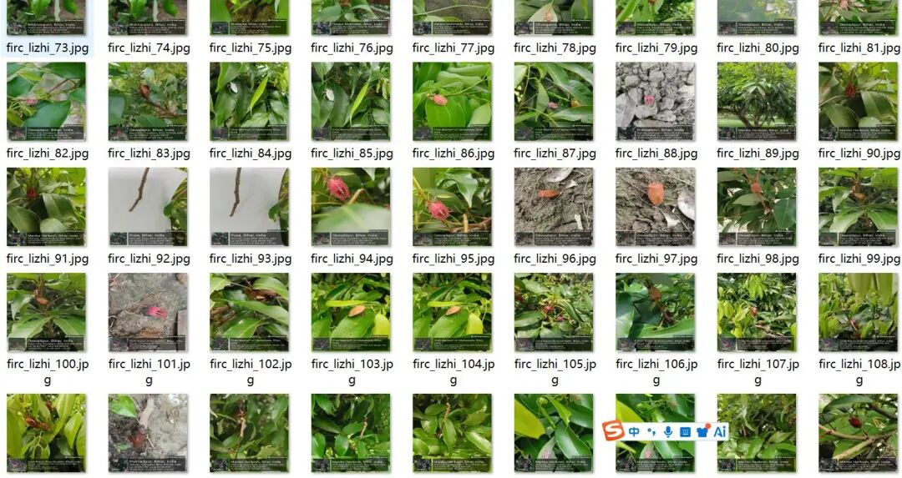
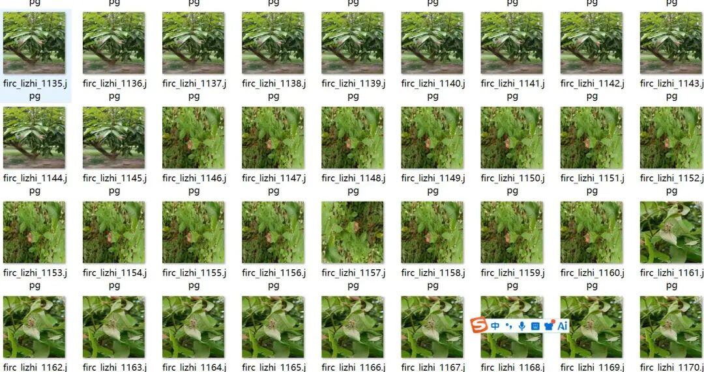
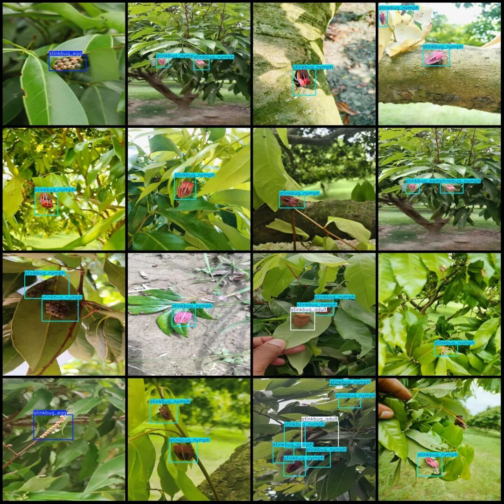
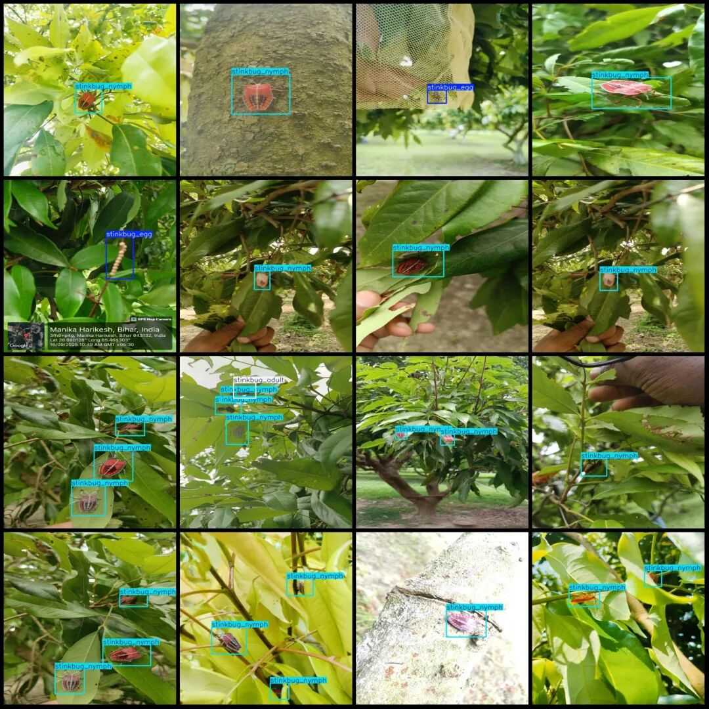

# Smart Orchard Litchi Pest Detection Dataset in VOC+YOLO format with 1499 images and 4 categories with enhanced features

Please note that about half of the dataset consists of enhanced images. Please pay attention to the image previews.

Dataset format: Pascal VOC format + YOLO format (txt file without split path, only containing jpg images and corresponding VOC format xml files and yolo format txt files)

Number of images (number of jpg files): 1499

Number of annotations (number of xml files): 1499

Number of annotations (number of txt files): 1499

Labeling category count: 4

Label category names (note that the order of categories in the Yolo format does not correspond to this, but is based on the labels folder's classes.txt): ["stinkbug", "stinkbug_adult", "stinkbug_egg", "stinkbug_nymph"]

Number of boxes labeled in each category:

stinkbug (chrysomela) Frames = 99

stinkbug_adult (Chrysomela) Frames = 344

stinkbug_egg (Chrysomela egg) Frames = 124

stinkbug_nymph (Chrysomela) = 1994

Total frame count: 2561

Number of images per category:

stinkbug (chrysomela) occupies = 90

stinkbug_adult (Chrysomela) occupies = 299

stinkbug_egg (Chrysomela egg) occupies = 124

stinkbug_nymph (Aphid nymph) occupies = 1141

Image resolution: 512x512

Using labelImg:

Annotation rules: Draw a rectangle around the category.

Important Notice: The dataset does not have separate training, validation, and test sets; you need to partition them yourself.

Special : This dataset does not guarantee the accuracy of the trained models or weight files.

Image Preview:

Annotation example:

## Payment

Here is a pay link on Stripe ( https://buy.stripe.com/3cs8yP7sY87d0vu9AB ). Please contact me lonlonago@foxmail.com after funding $89, and I will send you a complete data files , thank you!

